# BiteOrbit

> **Great food. Great local places. Right to your door.**
> A full-stack, multi-sided food ordering platform: customer storefront, restaurant
> partner console, delivery-partner app and platform administration — with a real
> Go backend, PostgreSQL persistence and an honest local demo dataset.

**Status: local demo build.** Everything runs on your machine with synthetic data
(the demo city of *Bitepur*), simulated payments, fake SMS and captured email. No real
orders are fulfilled and no real money moves. See [Integrations](#integrations-what-is-simulated)
for exactly what is real and what is simulated.

---

## Screenshots

All screenshots below are genuine captures from the running application with the
seeded demo dataset (see `e2e/tests/06-screenshots.spec.ts` — the suite that
produces them).

### Customer discovery — desktop
The BiteOrbit storefront: demo-city banner, debounced search, curated collections,
cuisine chips, veg/price/sort filters (reflected in the URL) and the restaurant grid
with open/closed states.

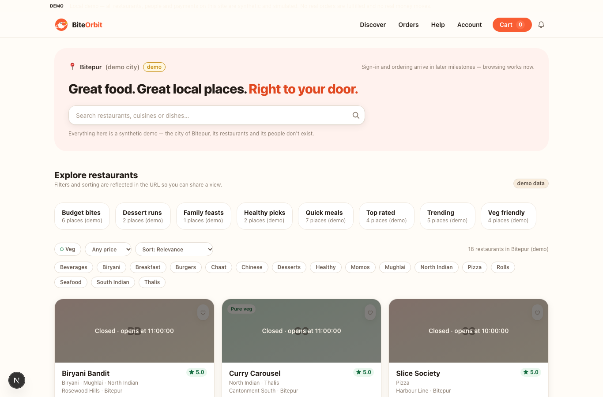

### Customer discovery — mobile
The same storefront, mobile-first: thumb-friendly layout, readable hierarchy.

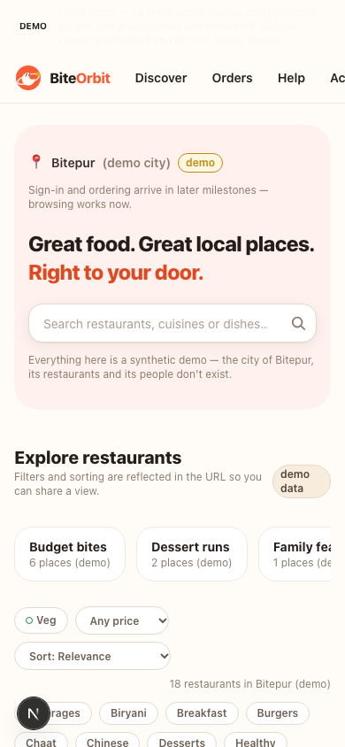

### Restaurant menu
Outlet detail with hours, rating (from real review rows), allergen notes attributed
to the restaurant, category navigation, menu search and veg filter.

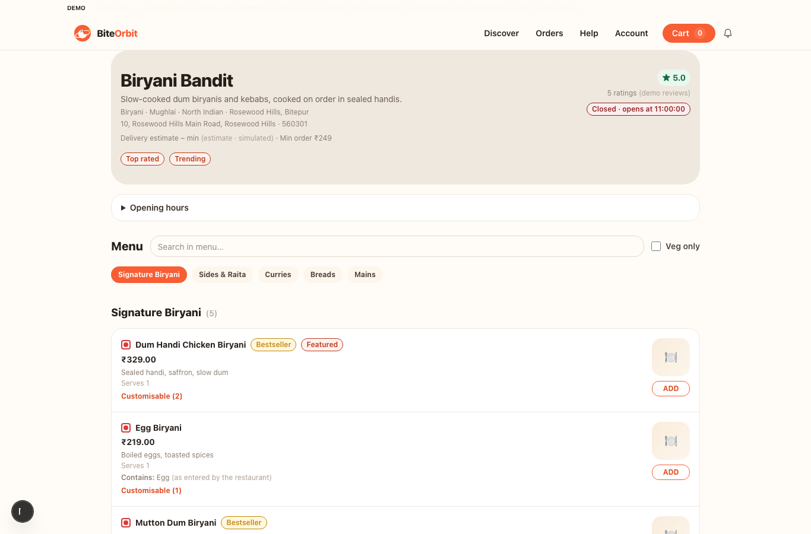

### Item customisation
Modifier groups enforced client- and server-side (required groups, min/max select,
availability), quantity stepper, special instructions and a live price preview.
The server re-validates every choice on add.

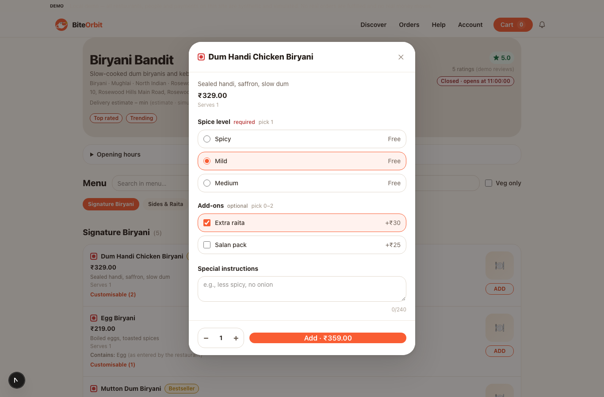

### Cart
Persistent single-restaurant cart with per-line modifiers, quantity steppers and
server-revalidated availability/price flags. Fees are deliberately absent here —
the authoritative quote comes from the server at checkout.

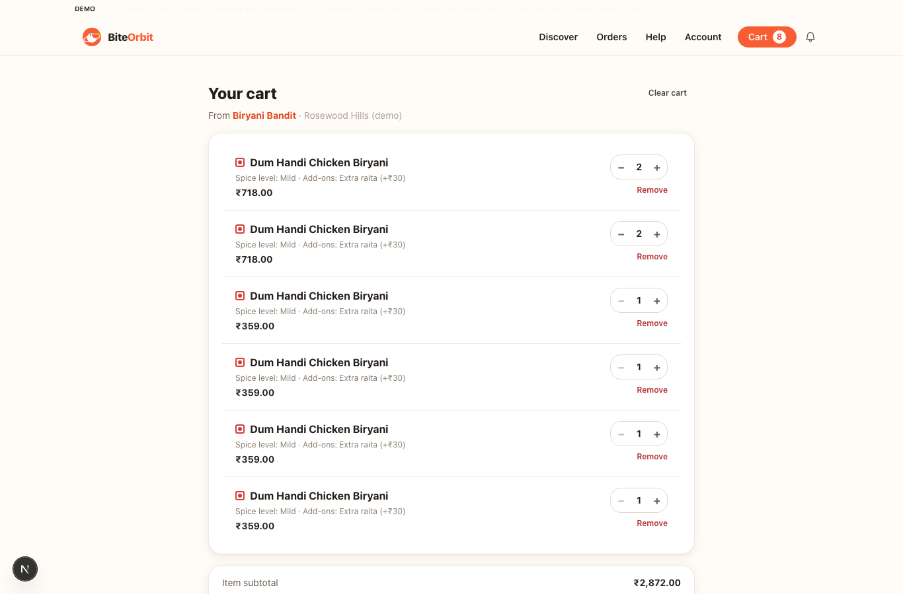

### Checkout — server-priced breakdown
The authoritative quote: item subtotal, coupon discount, packaging, delivery fee
(free above a threshold), platform fee, per-component GST lines and the grand total —
all computed server-side in integer paise and snapshotted to the order. Simulated
payment methods are labelled as such.

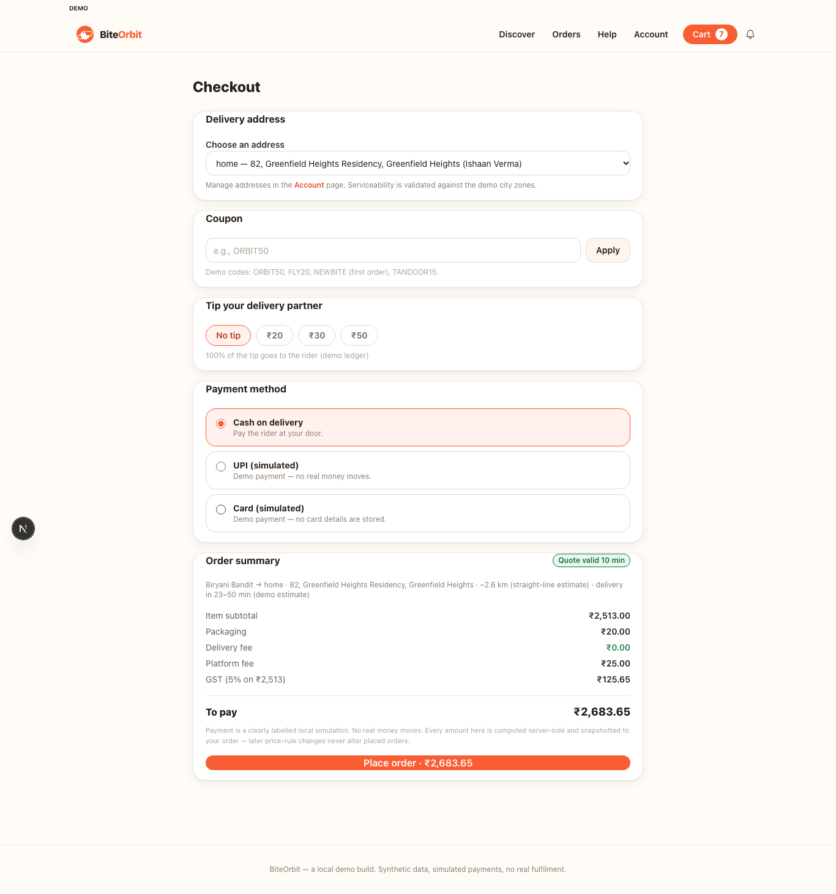

### Order tracking
Live status timeline (placed → confirmed → preparing → ready → rider → delivered),
full event history, payment status, frozen price snapshot, rider identity after
acceptance and the demo tracking note (no fake GPS).

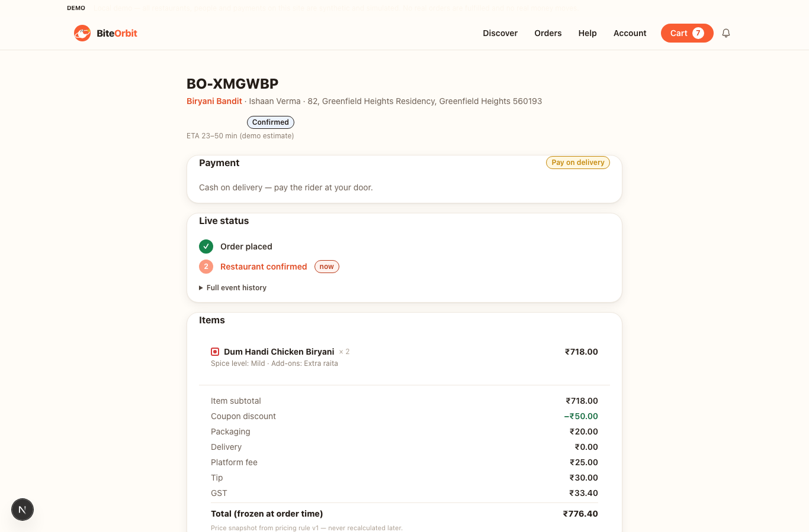

### Customer order history
Order history with status and payment chips, totals and demo estimates.

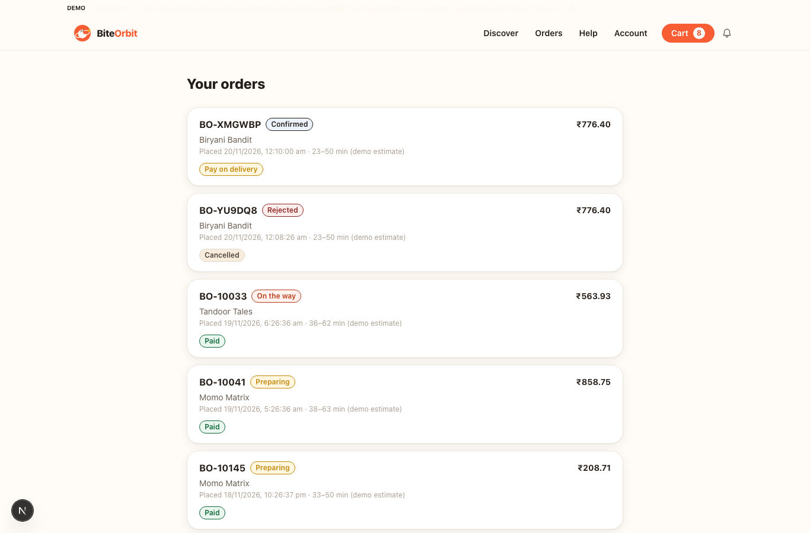

### Restaurant dashboard
Partner analytics with documented metric definitions: orders, GOV (gross order
value — *not* payout), net sales, AOV, cancellation rate and average prep time,
plus popular items and a data-freshness stamp.

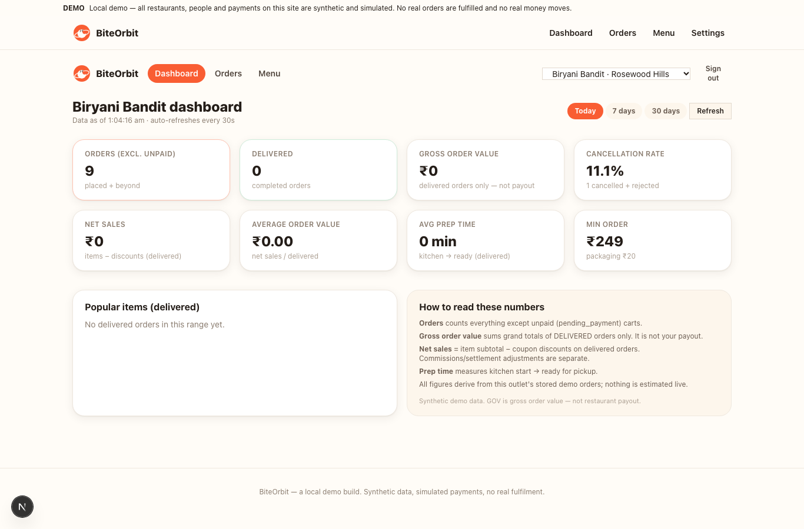

### Restaurant order management
The order queue with item summaries, customer notes and one-click accept /
reject-with-reason / prepare / ready transitions. A print-friendly kitchen ticket
opens from any in-flight order.

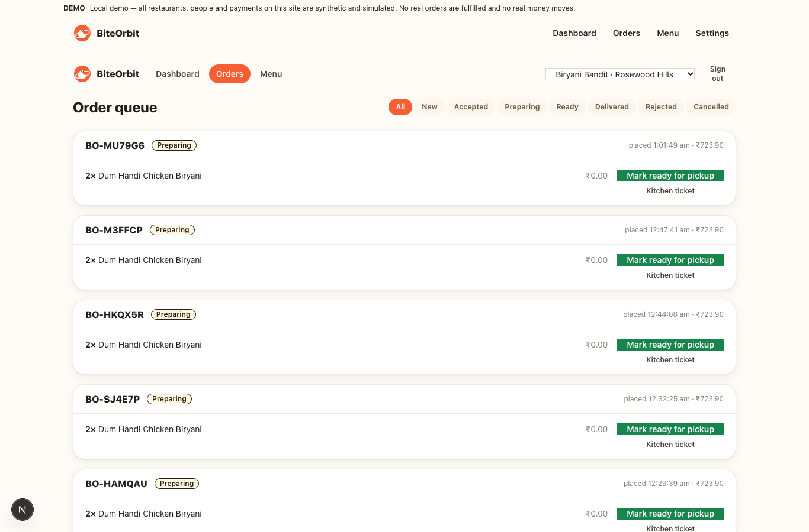

### Restaurant menu management
Availability toggles (instantly reflected to customers), price and name editing —
every change audited with before/after state.

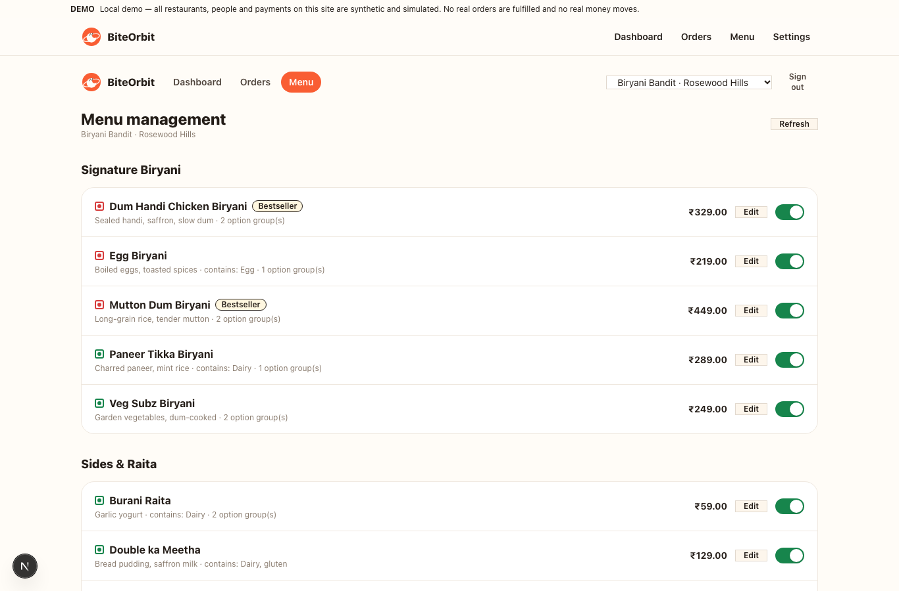

### Courier dashboard
Delivery-partner console with online/offline availability, earnings ledger totals
(never rider-editable) and recent day breakdowns.

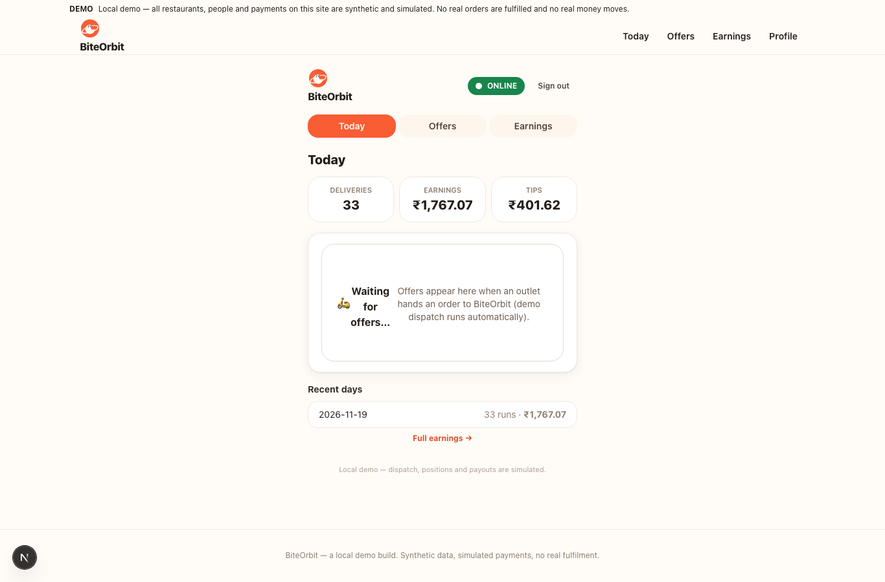

### Admin overview
Platform metrics with the same honest definitions: order volume by status, GOV,
platform fees, refunds, coupon cost, active outlets, pending applications, rider
availability and open tickets.

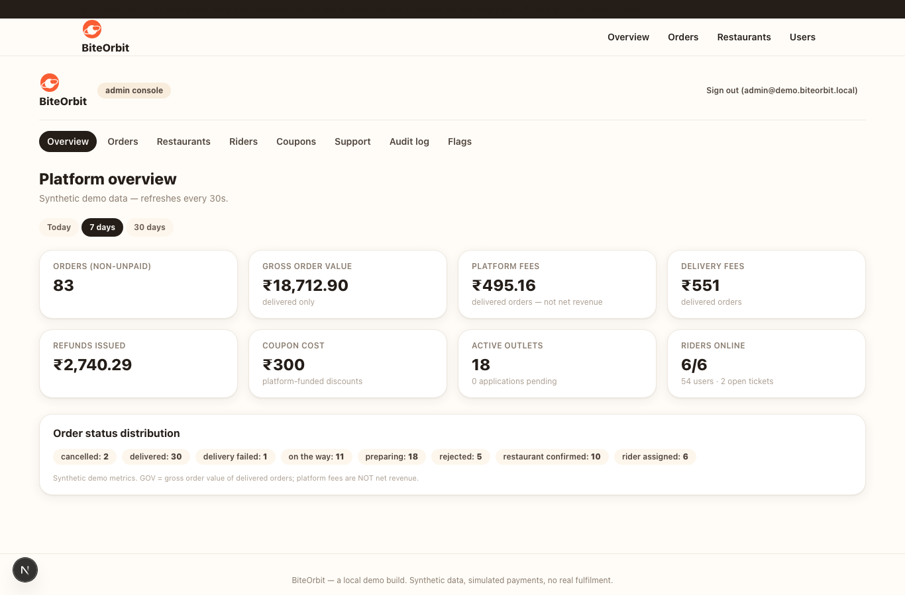

### Admin order management
Platform-wide order search (reference/outlet/customer) with status filters and
audited administrative cancellation (ops roles only, mandatory reason).

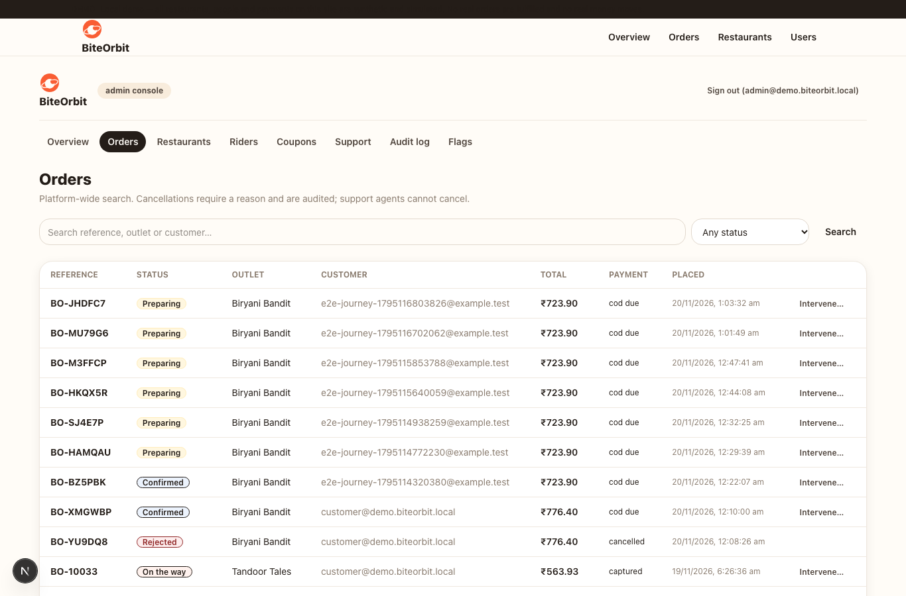

### Admin restaurant review
Organisations, outlets and the application review flow — approve / request changes /
reject with a mandatory note. Demo approvals are explicitly simulations, not legal
verification.

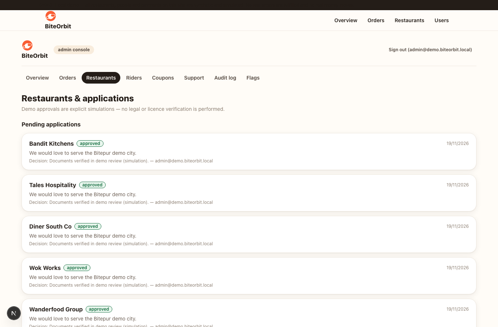

### Support tickets
Customer ticket creation (order-linked, categorised) and the agent queue with
internal notes that are never exposed to customers.

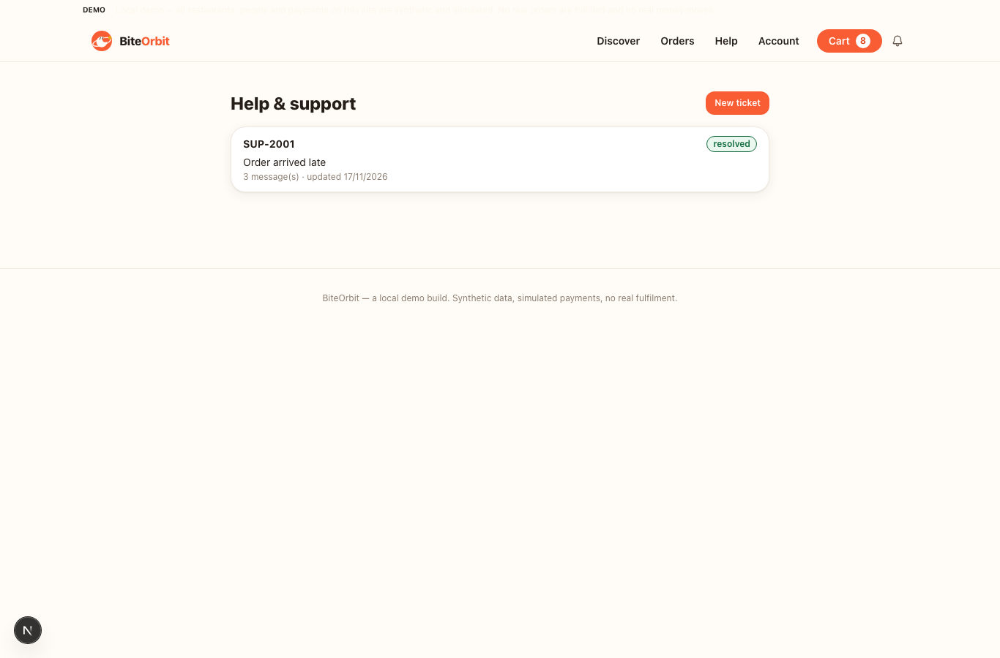

---

## Features

### Customer
- Discovery: debounced search with suggestions (restaurants/cuisines/dishes),
  collections, cuisine chips, veg + price + sort filters in URL params, honest
  open/closed states computed from outlet hours and holidays
- Menu browsing with modifier groups (required/min/max enforced server-side),
  allergen notes, serving info, availability
- Persistent single-restaurant cart; cross-restaurant adds require explicit
  confirmation — never silently erased
- Checkout with expiring server-priced quotes, coupons (validated with specific
  reasons: expired, min-order, per-user limit, new-user-only, outlet mismatch),
  tips, COD or clearly-labelled simulated UPI/card
- Idempotent order placement (`Idempotency-Key`), stale-quote and cart-tamper
  rejection
- Order tracking with the full append-only event trail; cancellation within the
  policy window (auto-refund of captured payments, simulated locally)
- Reviews on delivered orders (once per order, moderated), favourites, reorder at
  current prices, notification centre with per-category preferences, support tickets
- Privacy controls: logout-all-sessions, session rotation on refresh

### Restaurant
- Outlet-scoped portal (organisation owner / manager / staff roles, enforced
  server-side)
- Order queue with accept / reject-with-reason / prepare / ready transitions;
  double-accept races resolve safely; restaurants can never mark orders delivered
- Auto-timeout: orders unaccepted for 15 minutes are auto-rejected with refunds
  (documented demo policy)
- Menu management: availability toggles, name/description/price edits — all audited
- Analytics with documented definitions (GOV ≠ payout; net sales; AOV; cancellation
  rate; average prep time) and CSV export

### Courier
- Availability toggle (approved riders only), deterministic dispatch (fairness +
  proximity scoring, atomic offer claim — exactly one winner)
- Delivery lifecycle: accepted → arriving → arrived → picked up → on the way →
  delivered (OTP-verified) or delivery_failed with refund handling
- Earnings ledger (base + incentive + tips); payouts are platform actions riders
  cannot perform
- Offers hide the customer's exact address until acceptance

### Admin
- Role tiers: admin, ops manager, support agent (reduced permissions)
- Platform overview, order search + audited interventions, user suspension
  (revokes sessions), restaurant application review, rider approve/suspend,
  coupon management, feature flags, immutable audit log of every administrative
  action
- Support queue with internal notes (never shown to customers)

---

## Architecture

```
              ┌──────────────────────────────────────────────┐
              │           Browsers (PWA-ready)               │
              │  customer :3000   restaurant :3001           │
              │  courier  :3002   admin     :3003            │
              └──────────────┬───────────────────────────────┘
                             │ same-origin /api/v1/* proxy
                             ▼
              ┌──────────────────────────────┐
              │        Go API :8080          │
              │ HTTP + SSE, RBAC, pricing    │
              │ orders state machine, outbox │
              └───┬─────────┬─────────┬──────┘
                  │         │         │
       ┌──────────▼──┐ ┌────▼────┐ ┌──▼──────────────┐
       │ PostgreSQL  │ │  Redis  │ │ Provider        │
       │ migrations  │ │ ratelmt │ │ adapters:       │
       │ + data      │ │ pubsub  │ │ payments (mock, │
       └─────────────┘ └─────────┘ │ HMAC webhooks)  │
       ┌─────────────┐             │ sms (fake)      │
       │ Outbox      │────────────►│ email (Mailpit) │
       │ dispatcher  │ jobs/notify │ maps (demo sim) │
       └─────────────┘             │ storage (files) │
                                   └─────────────────┘
```

- **Four Next.js apps** (App Router, TypeScript, Tailwind CSS v4) share
  `@biteorbit/ui` (design system) and `@biteorbit/api-client` (typed API access).
- **Go API** — single module at `services/api`: chi-free stdlib router with a
  central route registry that *generates* the OpenAPI document (a test fails CI
  when a served route is undocumented).
- **PostgreSQL** is the source of truth: 56+ tables, explicit FKs/checks,
  embedded sequential migrations (`internal/migrations/*.sql`).
- **Integer paise everywhere** — the pricing engine (`internal/pricing`) computes
  every quote with integer math and documented half-up rounding; orders freeze a
  full pricing snapshot so rule changes never alter history.
- **Transactional outbox** — state changes and their events commit atomically;
  the dispatcher fans out to notification workers and the dispatch engine with
  retry/backoff/dead-letter.
- **State machine** — the order lifecycle (placed → confirmed → preparing →
  ready → rider_assigned → picked_up → on_the_way → delivered, plus
  rejected/cancelled/delivery_failed) is guarded by conditional `UPDATE … WHERE
  status = expected` and every transition appends an immutable `order_events` row.

Details: [docs/architecture/overview.md](docs/architecture/overview.md),
[state machine](docs/architecture/state-machine.md),
[glossary](docs/architecture/glossary.md), ADRs in
[docs/decisions/](docs/decisions/), runbook in
[docs/operations/local-runbook.md](docs/operations/local-runbook.md), API:
[docs/api/openapi.json](docs/api/openapi.json) (also served at `/api/v1/openapi.json`).

---

## Prerequisites

- Docker Desktop (or any Docker engine)
- Node.js ≥ 20 + pnpm ≥ 9 (`corepack enable`)
- Go ≥ 1.25 (developed on 1.27)

## Quick start

```bash
pnpm install                # workspace dependencies
pnpm compose:up             # PostgreSQL :54329, Redis :54380, Mailpit :51080
pnpm migrate                # apply schema migrations
pnpm seed                   # load the synthetic BiteOrbit demo dataset
pnpm dev                    # API :8080 + customer :3000 + restaurant :3001
                            # + courier :3002 + admin :3003
```

Open the customer app at **http://localhost:3000** and sign in with a demo account.

Full reset at any time:

```bash
pnpm reset                  # volumes down -v → up → migrate → seed
```

## Demo accounts (local only)

All demo accounts share the password **`Demo@1234`**. They exist only in the seeded
local database — never reuse these credentials elsewhere.

| Role | Email |
| --- | --- |
| Customer | `customer@demo.biteorbit.local` |
| Restaurant manager (Biryani Bandit) | `manager01@demo.biteorbit.local` |
| Restaurant owner | `owner01@demo.biteorbit.local` |
| Delivery partner | `rider@demo.biteorbit.local` |
| Platform admin | `admin@demo.biteorbit.local` |
| Ops manager | `ops@demo.biteorbit.local` |
| Support agent | `support@demo.biteorbit.local` |

The seed is deterministic — the same dataset (city, 18 outlets, ~180 historical
orders across every lifecycle state, coupons in various states, reviews, tickets)
is rebuilt identically on every `pnpm reset`.

## Commands

| Command | What it does |
| --- | --- |
| `pnpm dev` | API + all four portal dev servers |
| `pnpm migrate` / `pnpm migrate:status` | apply / list SQL migrations |
| `pnpm seed` | rebuild the deterministic demo dataset |
| `pnpm reset` | full local reset (wipes volumes) |
| `pnpm lint` / `pnpm typecheck` | ESLint / tsc across the workspace |
| `pnpm test:web` | Vitest (packages + apps) |
| `pnpm test:api` | Go unit + integration tests (real test database) |
| `pnpm build` | production builds of all four apps |
| `pnpm --filter @biteorbit/e2e test` | Playwright journeys (needs the stack running) |
| `pnpm --filter @biteorbit/e2e screenshots` | regenerate `docs/screenshots/*.png` |

The Go test suite creates its own `biteorbit_test` database from the embedded
migrations — no manual setup. CI (`.github/workflows/ci.yml`) runs lint, typecheck,
web tests, Go tests against real Postgres/Redis services, production builds and the
OpenAPI route-coverage check on every push/PR.

## Project structure

```
BiteOrbit/
├── apps/
│   ├── customer-web/        # storefront (Next.js, port 3000)
│   ├── restaurant-web/      # partner console (3001)
│   ├── courier-web/         # delivery-partner console (3002)
│   └── admin-web/           # platform administration (3003)
├── packages/
│   ├── ui/                  # design system: tokens, primitives, StatusChip
│   └── api-client/          # typed API access for all portals
├── services/api/            # Go backend (single module)
│   ├── cmd/{api,migrate,seed,worker}/
│   ├── internal/            # auth, cart, checkout, courier, discovery,
│   │                        # dispatch, orders, payments, portal, pricing,
│   │                        │ reviews, server, support, users, workers…
│   └── migrations/          # embedded SQL migrations
├── e2e/                     # Playwright journeys + screenshot suite
├── docs/
│   ├── architecture/        # overview, state machine, glossary
│   ├── decisions/           # ADRs 000–007
│   ├── operations/          # local runbook
│   ├── api/                 # generated OpenAPI document
│   └── screenshots/         # genuine captures (embedded above)
├── scripts/                 # dev/migrate/seed/reset helpers
└── docker-compose.yml       # Postgres + Redis + Mailpit
```

## Configuration

`.env.example` documents every variable with safe local defaults. Highlights:

- `BITEORBIT_DATABASE_URL`, `BITEORBIT_REDIS_URL` — service locations
- `BITEORBIT_PAYMENT_ADAPTER=mock` — local simulated gateway (HMAC-signed webhooks)
- `BITEORBIT_SMS_ADAPTER=fake` — logs only, never transmits
- `BITEORBIT_EMAIL_ADAPTER=mailpit` — captures mail at http://localhost:51080
- `BITEORBIT_MAPS_ADAPTER=demo` — deterministic straight-line estimates

**Production guard:** the config validator refuses to boot in `production` with
any fake/mock adapter or a short session secret — simulated providers cannot ship
accidentally.

## Testing

| Layer | Coverage |
| --- | --- |
| Go unit | pricing vectors (tax allocation, caps, rounding), coupons, Argon2 passwords, webhook signature/replay, geo determinism, storage path traversal, config production guards |
| Go integration | full journeys against a real test database: auth/session rotation, password reset (token via captured email), address IDOR, cart modifiers + conflicts, checkout quote/place/idempotency/stale-quote, payment capture/failure/retry, webhook tamper/replay, courier dispatch + OTP delivery, no-rider honesty, portal scoping + fulfilment, admin reviews/suspension/coupons, reviews/favourites/reorder, cross-role RBAC |
| Web | Vitest: money formatting, API envelopes, UI smoke |
| E2E | Playwright: the four portal journeys + screenshot generation |

Concurrency is verified with `go test -race` (idempotent placement, atomic offer
claim, coupon redemption counters, outbox claiming).

## Integrations (what is simulated)

| Capability | Local adapter | Production path |
| --- | --- | --- |
| Payments | `mock` provider: HMAC-signed webhooks, amount/order matching, idempotent event processing — **clearly labelled simulated** | Swap the `payments.Provider` implementation (Razorpay/Stripe/PayU); the verification path is identical |
| SMS/OTP | `fake` sender — logs only, never transmits | `notify.SMSSender` implementation (Twilio/MSG91) |
| Email | Mailpit capture (http://localhost:51080) | SMTP provider via `notify.EmailSender` |
| Maps/distance | Deterministic demo simulator (straight-line × 1.3, labelled estimate) | `geo` provider (Google/Mapbox) with consent-based rider GPS |
| Object storage | Filesystem under `data/uploads/` (path-traversal hardened) | `storage.Store` implementation (MinIO/S3) |

Payment card details are never collected or stored. UPI/card options in checkout
are demo simulations of a provider flow; COD uses its own due/collected lifecycle.

## Known limitations

- **Local demo only** — no hosted deployment; production needs hosting, managed
  Postgres, a domain with TLS and real provider credentials (none are supplied).
- The seeded reviews, orders and tickets are synthetic (labelled as demo data in
  the product); live review counts come only from rows that actually exist.
- Restaurant application approval and rider activation are demo simulations of a
  human review process.
- Demo rider positions are deterministic simulations — no live GPS.
- Commissions/settlements are modelled (rules + summaries) but payout transfers
  are not simulated end-to-end.
- Group ordering, scheduled slots and wallets are behind feature flags but not
  implemented.

## License note

Original BiteOrbit branding, code and copy. Competitor products were used only as
functional references — no proprietary assets, logos or text were copied.
